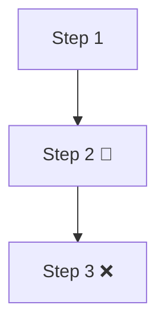
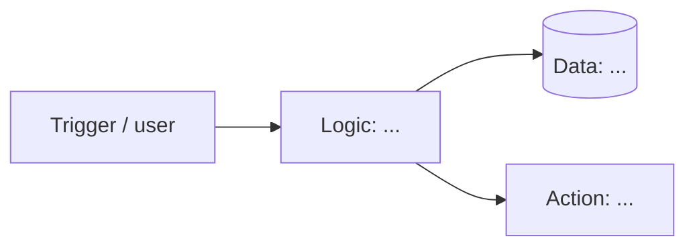

# Soul of Nature

Soul of Nature is a wellness and men's grooming brand focused on natural
personal-care, fragrance, and wellness products.

<!--
  Product 2 Spec Template
  Copy everything in this file into the README.md of your Product 2 repository.
  Walkthrough, examples, and AI prompts: https://github.com/464squad/IEL/tree/main/projects/product-2
  Delete these instructions and the italic hints as you fill each section in.
  Privacy: no customer names, contact info, prices/revenue, or anything your partner asked to keep private.
-->

# [Product Name]

> One line: what this is, and who it helps.

**Partner:** [Business name, or a nickname like "a Bronx barbershop"] · **Partner's role:** [owner / manager]
**Team:** [Your name(s)] · **Course:** CMP 464/343 Product 2 · **Last updated:** [date]
**Live demo:** [deployment URL, video link, or "see Demo section"]

---

## 1. About the Partner

*What do they do, who are their customers, and what are they trying to grow or improve?*

[Your answer]

---

## 2. Discovery Log

*One entry per conversation. Use the notes template from the Discovery Guide.*

### Conversation #1 · [date] · [in person / phone] · with [role]
- **Their goals:**
- **How the work happens today:**
- **Pain points** (how often · what it costs):
- **Tools they use now:**
- **What they've tried / wish existed:**
- **Best quote:** "..."

### Conversation #2 · [date] · …

---

## 3. Workflow Map (today)

*Show how the work happens now, step by step. Mark 🔴 slow · 🔁 repetitive · ❌ error-prone · 🕳️ falls through the cracks. Use a Mermaid diagram or a photo.*



---

## 4. Problem Statement

> **When** [a specific moment that keeps happening],
> **[partner] struggles to** [what goes wrong],
> **which costs them** [time / money / stress, with numbers from discovery].
> **This happens because** [root cause].
> **Right now they** [current workaround], **but** [why it falls short].

**They'll know this is solved when:** [something your partner could observe changing]

*Check: written about your partner, not you. Facts come from your discovery notes. No solution words (app, website, platform, dashboard, AI, automate…).*

---

## 5. Existing vs Desired Solutions

| Area | Today (existing) | Desired | Gap |
|---|---|---|---|
| | | | |
| | | | |

**Solution type:** [use an existing tool better / automation / custom app / a mix]. *Why does this fit your partner?*

---

## 6. Features & Benefits

| Feature (what it does) | Benefit for the partner | MVP or Later? |
|---|---|---|
| | | |
| | | |
| | | |

**MVP (2–3 features):**
-

**Later:**
-

**Not doing:**
-

---

## 7. Tech Stack & Architecture

### Surface
- **Surface:** [Web / Mobile / Desktop / CLI / Chat / Automation (+ simple interface)]
- **Why:** *Where and how will your partner (or their customers) use it?*

### Stack
| Piece | Choice | Why |
|---|---|---|
| Front end / interface | | |
| Back end / automation logic | | |
| Data | | |
| Outside services / APIs | | |
| Hosting / where it runs | | |

### Architecture
*Show how a trigger or request flows through the system.*



---

## 8. Solution Brief (for your partner)

*One page, written in **plain language**: no tech jargon. You should be able to hand this to your partner.*

**The problem we heard:** [1–2 sentences, in their words]

**What we're building:** [1–2 sentences]

**How it will help:** [time saved, money saved, fewer mistakes]

**What you'll need to do:** [e.g. "fill out a form when a customer books" / "nothing, it runs automatically"]

**What it won't do (yet):** [scope limits]

---

## 9. Demo

*Screenshots, a GIF, a video (under 2 min), or a live link. For automations, show the whole flow from trigger to result.*


---

## 10. Partner Feedback

**Date and format:** [in person / video call]

- "Quote 1"
- "Quote 2"

**What worked:**
**What didn't / was confusing:**
**What they'd want next:**

---

## 11. Team *(pairs only)*

| Teammate | What I did (discovery, features, files) |
|---|---|
| | |

---

## 12. What We Learned

*What you didn't know at first, how you figured it out (which tools, tutorials and AI), where the AI got it wrong, and what you'd do differently.*


## Project structure - Copilot notes 

- `backend/` — FastAPI application, database models, seed data, and tests.
- `frontend/` — Next.js storefront with Tailwind CSS and shadcn/ui.

The backend provides health, category, product, and order endpoints. The
storefront includes a catalog, category filters, and product detail pages backed
by the API. Guests can add items to a cart saved in browser localStorage and
create a pending order for Stripe test checkout. Cart prices and stock are
refreshed from the API when viewing the cart, and are not reserved.
The About, Contact, and Shipping & Returns pages are available in the
storefront. Contact information and shipping/returns policies are not yet
configured and must be supplied before launch.

## Admin API

The admin API uses a single shared bearer token. Before starting the backend,
generate a long random token and set it in the server's environment:

```powershell
$env:ADMIN_API_TOKEN = .\.venv\Scripts\python.exe -c "import secrets; print(secrets.token_urlsafe(32))"
```

Run this from `backend/`. Keep the token secret; do not commit it, put it in
frontend source code, or expose it in browser-delivered configuration.
All `/api/v1/admin` endpoints require an `Authorization: Bearer <token>`
header. An unset, non-ASCII, or shorter-than-32-character token disables the
admin API with a 503 response. Use a newly generated token whenever rotation is
needed. This shared-token mechanism is intended for development and trusted
administrators; it does not provide user accounts, individual access control,
rate limiting, or audit logging. Use HTTPS and a secure authentication
solution before production deployment.

For local development only, the frontend also has an admin interface at
`http://127.0.0.1:3000/admin`. In the frontend terminal, set
`$env:ADMIN_LOCAL_ENABLED = "true"` and set `$env:ADMIN_API_TOKEN` to the same
token used by the backend before starting Next.js. Keep both services bound to
localhost. The token stays on the server after sign-in; the browser receives
an HttpOnly session cookie that expires after eight hours. Do not enable this
local interface on a public server: it has no account-level authorization,
rate limiting, audit logging, or production-ready session management.

- `GET /api/v1/admin/products` and `GET /api/v1/admin/products/{id}` include
  inactive products.
- `POST /api/v1/admin/products` creates a product; `PUT /api/v1/admin/products/{id}`
  replaces its fields. See `/docs` for the request schema. Category IDs come
  from `GET /api/v1/categories`.
- `DELETE /api/v1/admin/products/{id}` deactivates the product, preserving
  order history; set `is_active` to `true` via `PUT` to restore it.
- `GET /api/v1/admin/orders` lists orders, newest first, including their items.
  Both admin lists accept `limit` (1–100, default 20) and `offset` (default 0).

The test-mode checkout endpoint, `POST /api/v1/checkout/sessions`, accepts an
order's `email` and `order_number` and returns a Stripe-hosted `checkout_url`.
It uses the order's stored prices. Configure the following environment
variables before starting the backend:

```powershell
$env:STRIPE_SECRET_KEY = "sk_test_..."
$env:STRIPE_WEBHOOK_SECRET = "whsec_..."
$env:STRIPE_SUCCESS_URL = "http://localhost:3000/success"
$env:STRIPE_CANCEL_URL = "http://localhost:3000/cart"
```

Only test secret keys are accepted. The customer reviews the server-priced
pending order before proceeding to Stripe. The order number and email are
retained in the current browser tab's session storage for checkout retries and
the success page; record the order number to look it up later at `/orders`.
The cart is not automatically cleared after payment. A checkout session is
reused for retries. If it expires, the customer must create a new order; an
interrupted session creation may require manual reconciliation after 23 hours
to avoid accidentally charging twice.

Forward Stripe test events to `POST /api/v1/webhooks/stripe`, for example with
the Stripe CLI:

```powershell
stripe listen --forward-to localhost:8000/api/v1/webhooks/stripe
```

Set `STRIPE_WEBHOOK_SECRET` to the signing secret printed by the CLI and
restart the backend. A verified paid checkout marks the matching order `paid`;
the browser's success redirect does not confirm payment. These endpoints are
for development only: inventory reservation, shipping, tax, refunds, and
production payment handling are not implemented.

## Backend setup

With Python 3.10 or newer, Node.js 20.9 or newer, npm, and GNU Make installed,
run the following from the repository root in PowerShell:

```powershell
make setup
make seed
make api
```

In a second terminal at the repository root, run `make frontend` to serve the
storefront at `http://localhost:3000`. Stop each server with Ctrl+C.
Run `make test` for backend tests, `make frontend-check` for a production build
and type check, or `make help` to list the shortcuts. If the backend is already
set up, use `make frontend-setup` to install only the frontend dependencies.
The backend commands run in `backend/`, so the default SQLite database is
created there. `make seed` adds missing sample data without deleting existing
records. If a port is already in use, choose another with, for example,
`make frontend FRONTEND_PORT=3001` or `make api API_PORT=8001`.

On Windows, Make uses the Python launcher (`py -3`); on macOS and Linux, it
uses `python3`. Set a different interpreter when needed, for example
`make setup PYTHON=python`. GNU Make is not included with Windows by default;
install it separately or use the manual commands below.

Without Make, run the following from the repository root in PowerShell:

```powershell
cd backend
python -m venv .venv
.\.venv\Scripts\python.exe -m pip install -r requirements.txt
.\.venv\Scripts\python.exe -m app.seed
.\.venv\Scripts\python.exe -m uvicorn app.main:app --reload
```

The API is available at `http://127.0.0.1:8000`, with interactive documentation
at `http://127.0.0.1:8000/docs`. Run the tests from `backend/` with:

```powershell
.\.venv\Scripts\python.exe -m pytest
```

By default, the application uses `soul_of_nature.db` in the current working
directory, so run the backend commands from `backend/`. Set the `DATABASE_URL`
environment variable before starting the application to use another database.

If you previously ran the backend from `frontend/backend/`, its ignored local
database and virtual environment remain there. To retain that database, stop
the application and copy the database to `backend/soul_of_nature.db` before
running the seed or server commands; do not overwrite an existing database
without first checking it. Create a fresh virtual environment in `backend/`
instead of moving the old one.

## Frontend setup without Make

From the repository root:

```powershell
cd frontend
npm ci
npm run dev
```

Open `http://localhost:3000` in a browser.
Run `npm run build` in `frontend/` to verify the production build.
The shop reads the API on the Next.js server at `http://127.0.0.1:8000` by
default. Start and seed the backend first. If it runs elsewhere, set
`API_BASE_URL` in the frontend's environment before starting Next.js, for
example `$env:API_BASE_URL = "http://127.0.0.1:8001"`.

## Frontend browser tests

After installing frontend dependencies, run `npx playwright install chromium`
once from `frontend/`, then run `npm run test:e2e` there (or `make frontend-test`
from the repository root). The command builds the frontend and starts an
isolated fixture API and storefront on ports 18791 and 13091; those ports must
be free. Tests use sample data in memory and do not touch the local database or
contact Stripe. Backend order and webhook behavior is tested separately by
`make test`; a real Stripe test-mode payment still needs manual verification.
